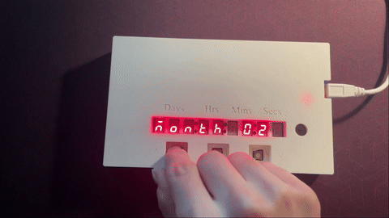

# Birthday Countdown Clock

A custom PCB that counts down to a chosen birthday in `days:hours:minutes:seconds` across nine 7-segment displays, and plays "Happy Birthday" through a magnetic transducer when the countdown reaches zero.



▶ **[Full demo video](https://youtu.be/9NLcifpYV80)**

---

## Overview

The clock takes the current time and a target date entered through three onboard pushbuttons, computes the remaining interval against a dedicated real-time clock, and refreshes the display once per second. When the RTC reaches the target month, day, hour, and minute, the countdown reads zero and a buzzer routine plays.

Designed, laid out, assembled, and programmed as a personal hardware project.

| | |
|---|---|
| **MCU** | ESP32-DEVKITC-32E |
| **Timekeeping** | DS3231MZ+TRL RTC (I²C, 400 kHz) |
| **Display driver** | MAX6951CEE+ (SPI, 1 MHz) |
| **Display** | 9 × SunLED XZFMDK07C, common cathode |
| **Audio** | PUI Audio SMTB-0927-TW-R magnetic transducer |
| **Power** | USB, 5 V in / 3.3 V logic |
| **Firmware** | C, ESP-IDF |
| **PCB** | 2-layer, designed in Autodesk EAGLE / Fusion Electronics |

### Pin map

| Function | GPIO | | Function | GPIO |
|---|---|---|---|---|
| I²C SCL | 22 | | Digit 9 — segment A | 2 |
| I²C SDA | 21 | | Digit 9 — segment B | 4 |
| SPI DIN | 23 | | Digit 9 — segment C | 17 |
| SPI CLK | 18 | | Digit 9 — segment D | 13 |
| SPI CS | 5 | | Digit 9 — segment E | 14 |
| Button — UP | 26 | | Digit 9 — segment F | 32 |
| Button — DOWN | 27 | | Digit 9 — segment G | 16 |
| Button — SET | 25 | | Digit 9 — decimal point | 19 |
| Buzzer | 33 | | | |

---

## Hardware

### Display driving

The countdown needs nine digits — three for days (up to 365), then two each for hours, minutes, and seconds. The MAX6951 drives eight of them. The ninth, which shows the ones place of the seconds, is driven **directly from eight ESP32 GPIOs** through discrete 145 Ω ballast resistors (R8–R15).

This split is the most interesting part of the display design, because the two halves behave differently:

- The **eight driven digits** are multiplexed by the MAX6951 at a rate set by its internal oscillator, and their segment current is constant-current regulated. No per-segment resistors are needed anywhere on that side of the board — one resistor, `RSET` (56 kΩ on ISET), sets the peak segment current for all of them. `CSET` (27 pF on OSC) works together with `RSET` to set the multiplex clock.
- The **ninth digit** is static. Its segments are held on continuously rather than duty-cycled, so it needs its own eight ballast resistors, and it draws current the whole time a segment is lit — roughly 9 mA per segment at 3.3 V assuming a ~2 V forward drop, or about 72 mA with every segment and the decimal point on. That is more average current than any single multiplexed digit, and matching its apparent brightness to the multiplexed eight is a real design consideration rather than an automatic result.

The decimal point on this ninth digit is toggled once per second, giving a visible "heartbeat" that confirms the loop is running.

**Why the MAX6951 over discrete shift registers:** it handles multiplex scanning, per-digit brightness, and **hexadecimal** decoding internally over SPI (the on-chip decoders are hexadecimal, 0–9 and A–F, selectable per digit — not BCD), and it keeps a static RAM per digit so individual digits can be updated without rewriting the whole display. A 74HC595 chain occupies the same three pins but pushes refresh timing onto the ESP32 and needs per-segment ballast resistors on every digit to hold brightness uniform. The MAX6951's segment drivers are also slew-rate limited to reduce EMI.

The driver is reconfigured between the two display modes: no-decode (`0x00`) during setup, so arbitrary segment patterns can spell out `YEAR`, `MONTH`, `DAY`, `HOUR`, `MIN`, `SEC`, and `BIRTHDAY`; and full hexadecimal decode (`0xFF`) during the countdown, so digits can be written as plain numbers.

### Timekeeping

A dedicated RTC was used rather than the ESP32's internal timer because the internal oscillator drifts badly and loses state on every reset.

Note the exact variant: the **DS3231M** (as in `DS3231MZ+TRL`) uses an on-chip **MEMS resonator**, not the temperature-compensated crystal oscillator of the plain DS3231. It is specified to **±5 ppm** from 0 °C to +40 °C — roughly 2.6 minutes per year — rather than the ±2 ppm of the TCXO part. Still far better than the ESP32 alone, and the MEMS resonator removes an external crystal from the BOM, but it is a meaningfully different specification from the one the part number's family is usually credited with.

**No backup cell is populated on this board.** There is no coin-cell holder in the schematic or the BOM, so `VBAT` is not battery-backed and the RTC does not retain time across a power cycle. In practice this means the clock re-enters setup mode on every boot. See [Possible improvements](#possible-improvements).

`INT/SQW` is also left unrouted, so the 1 Hz square-wave output the DS3231 can produce is unavailable to the firmware, and the display is updated by polling instead.

### Power

USB input at 5 V. There is no regulator on the custom board — the 3.3 V rail is supplied by the **AMS1117-3.3 already onboard the ESP32-DEVKITC-32E**, and the MAX6951, the RTC, and the LEDs all run from that single 3.3 V rail.

Running the display driver from the same 3.3 V rail as the ESP32 is deliberate. The MAX6951 is specified from 2.7 V to 5.5 V and its logic inputs are CMOS levels referenced to V+, so keeping it at 3.3 V means the ESP32's SPI lines drive it directly with no level shifting.

Worst-case current is dominated by the display: about 72 mA for the statically driven ninth digit, plus the multiplexed load of the MAX6951, plus roughly 80–160 mA for the ESP32 itself. That is within the regulator's rating, but it is worth knowing the headroom is not enormous, particularly inside an enclosure.

---

## User interface

Three tactile switches (Omron B3S-1000, active low, 10 kΩ pullups, 50 ms software debounce) drive the entire interface:

| Button | Function |
|---|---|
| **UP** | Increment the active field, wrapping at its limit |
| **DOWN** | Decrement the active field, wrapping at its limit |
| **SET** | Commit the active field and advance to the next |

Setup runs in two stages. First the current time — year, month, day, hour, minute, second — which is written to the DS3231. Then a `BIRTHDAY` prompt, followed by the target month, day, hour, minute, and second. Each field is shown with its name spelled on the display alongside the value, and field limits are enforced as you scroll, including a correct maximum day per month with leap-year handling.

Pressing **SET** during the countdown re-enters birthday setup without disturbing the clock.

**On persistence — worth being explicit:** the current time is stored in the DS3231's registers, but the target date is held only in RAM. Neither survives a power cycle on this build: the RTC has no backup cell, and the target is never written to flash. Both must be re-entered at every boot. The DS3231 cannot help here even in principle — unlike the DS1307, which has 56 bytes of battery-backed scratch RAM, the DS3231 has no general-purpose user RAM. Storing the target in the ESP32's NVS is the correct fix and is listed below.

---

## Firmware

`firmware/main.c` — a single ESP-IDF application. `app_main()` initialises the buzzer's LEDC channel, I²C, SPI, the MAX6951, the direct-driven GPIO digit, and the buttons; runs the two-stage setup; then enters a polling loop that ticks once per second via `vTaskDelay(pdMS_TO_TICKS(1000))`.

Each iteration reads all seven time registers from the DS3231 in one I²C transaction, converts them from BCD, computes the remaining days with `mktime()` and `difftime()` against a `struct tm` for the target (rolling to next year once the date has passed), then writes eight digits over SPI and the ninth over GPIO.

The buzzer is triggered by a software comparison inside that same loop rather than by an RTC alarm — when the current month, day, hour, and minute all match the target and seconds are zero, `play_birthday_song()` runs and a latch prevents it retriggering. An RTC-alarm implementation would not have helped: the DS3231's alarms can match on day-of-month but not on month, so an alarm would fire every month and need the same software filter anyway.

Notes are produced with LEDC hardware PWM at 10-bit resolution and 50% duty, with the frequency changed per note.

### Building

```bash
idf.py set-target esp32
idf.py build
idf.py -p COM3 flash monitor
```

Replace `COM3` with the board's port — on Linux or macOS this is typically `/dev/ttyUSB0`.

`main.c` is provided as the application source; drop it into the `main/` directory of an ESP-IDF project with a matching `CMakeLists.txt` to build.

---

## Repository structure

```
.
├── firmware/
│   └── main.c                    # Application firmware (ESP-IDF)
├── hardware/
│   ├── schematic.pdf             # Schematic
│   ├── board-layout.pdf          # PCB layout
│   └── bill-of-materials.pdf     # BOM
└── docs/
    └── demo.gif
```

---

## Manufacturing

Bare boards were fabricated by **JLCPCB** as a 2-layer design, with all components sourced separately from DigiKey and assembled by hand.

The part selection keeps that practical: every passive is 0805, the RTC is an 8-pin SOIC, and the display driver is a 16-pin QSOP. Nothing on the board is BGA or fine-pitch QFN, and the ESP32 DevKit sits on a through-hole footprint. The QSOP's 0.635 mm pitch is the tightest thing to solder by hand.

---

## Possible improvements

Working through the build surfaced a number of things worth changing:

1. **Persist the target date to NVS.** The birthday currently lives in RAM globals and is lost at every power cycle. `nvs_set_u8` for month and day, a `nvs_commit`, and a first-boot check would remove the most annoying part of using the device. Flash endurance is irrelevant here — this gets written a handful of times ever.

2. **Populate a backup cell on `VBAT`.** Without it the RTC's entire advantage over the ESP32's internal timer is lost the moment power drops. With NVS storing the target as well, a battery-backed RTC would mean the clock simply resumes on power-up with nothing to re-enter.

3. **Check the oscillator stop flag at boot.** Register `0Fh` bit 7 (`OSF`) is set whenever the oscillator has halted, which flags the stored time as meaningless. The firmware should read it and force time-set mode rather than counting down from garbage.

4. **Route `INT/SQW` to a GPIO** and drive the update from the DS3231's 1 Hz square wave instead of `vTaskDelay`. Polling works, but the update instant slowly drifts relative to the RTC's second boundary. Two things to get right: `INT/SQW` is open-drain and needs a pullup, and `INTCN` in register `0Eh` defaults to 1 (alarm mode) with `RS2:RS1` defaulting to 8.192 kHz — so square-wave output at 1 Hz requires explicitly clearing `INTCN` and writing `RS2 = RS1 = 0`, not inheriting defaults. The ISR itself should do nothing but notify a task; I²C must never be run from interrupt context.

5. **Buffer the buzzer.** The SMTB-0927-TW-R is a magnetic transducer with a 16 Ω coil and an 80 mA maximum rating. Through the 47 Ω series resistor from a 3.3 V GPIO, peak current is about **52 mA**, past the ESP32's 40 mA per-pin absolute maximum. PWM at 50% duty halves the average but not the peak. A small N-channel MOSFET or a 2N3904 would fix this properly.

6. **Drive the buzzer near its resonance.** That transducer's 95 dBA rating is at its 2.7 kHz resonant frequency, but the melody plays notes from 262 Hz to 494 Hz — one to three octaves below it. Output at those frequencies is far quieter than the part is capable of. Transposing the melody up, or accepting a single-tone alert at 2.7 kHz, would be dramatically louder for zero cost.

7. **Move segment A off IO2.** IO2 is a boot strapping pin on the ESP32. An LED to a common cathode is a weak enough pull-down that it boots fine in practice, but it is an unnecessary coupling between display state and boot behaviour. (IO5, used for SPI CS, is also a strapping pin, though it idles high and is far less likely to cause trouble.)

8. **Add a ground plane.** The current 2-layer layout routes ground as discrete traces. A poured plane on the bottom layer would lower impedance and simplify routing, and there is no signal on this board fast enough to make that difficult.

9. **Use the target's minute and second in the interval math.** Setup collects a target hour, minute, and second, but the countdown arithmetic effectively assumes a target minute of zero. The buzzer trigger does compare the minute correctly, so the tune fires at the right time — but the displayed remaining time can disagree with it for any target that is not on the hour.

10. **USB-C instead of USB-A**, and a proper enclosure — a nine-digit display is worth mounting behind a bezel.

---

## License

MIT — see [LICENSE](LICENSE).
