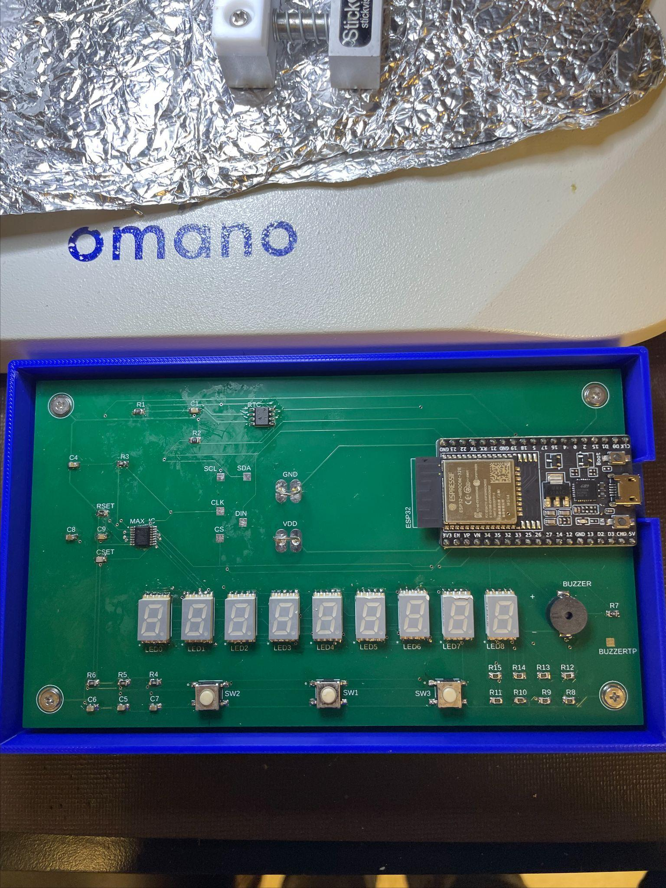
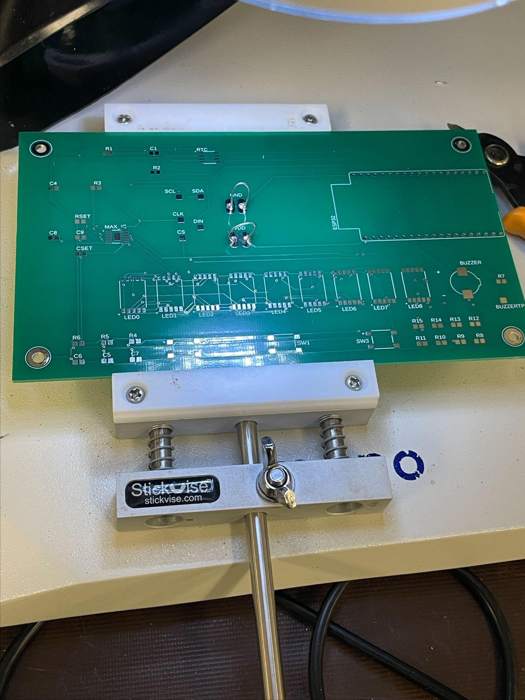

# Birthday Countdown Clock

A custom PCB that counts down to a birthday in `days:hours:minutes:seconds` on nine 7-segment displays and plays "Happy Birthday" on a buzzer when it reaches zero.

Final project for ESE 323 at Stony Brook University, Fall 2024, done solo: schematic, layout, assembly, and firmware. The board files are dated November 12, 2024, and the project was submitted December 8, 2024.


[Full demo video](https://youtu.be/9NLcifpYV80)



*The finished board in its printed case: nine displays, the MAX6951 on the left, the DevKit on the right, and the three setup buttons along the bottom edge.*

---

## Overview

Three buttons set the current time and the target date. A DS3231M real-time clock keeps time, the ESP32 works out the time remaining, and the display updates once a second. When the clock reaches the target month, day, hour, and minute, the countdown hits zero and the buzzer plays.

| | |
|---|---|
| **Course** | ESE 323, Stony Brook University, Fall 2024 |
| **MCU** | ESP32-DEVKITC-32E |
| **Real-time clock** | DS3231MZ+TRL (I²C, 400 kHz) |
| **Display driver** | MAX6951CEE+ (SPI, 1 MHz) |
| **Displays** | 9 × SunLED XZFMDK07C, common cathode |
| **Buzzer** | PUI Audio SMTB-0927-TW-R magnetic transducer |
| **Power** | 5 V from Micro-USB through the DevKit, 3.3 V logic |
| **Firmware** | C, ESP-IDF |
| **PCB** | 2 layers, designed in Autodesk EAGLE / Fusion Electronics |

### Pin map

| Function | GPIO | | Function | GPIO |
|---|---|---|---|---|
| I²C SCL | 22 | | Digit 9, segment A | 2 |
| I²C SDA | 21 | | Digit 9, segment B | 4 |
| SPI DIN | 23 | | Digit 9, segment C | 17 |
| SPI CLK | 18 | | Digit 9, segment D | 13 |
| SPI CS | 5 | | Digit 9, segment E | 14 |
| UP button (SW2) | 26 | | Digit 9, segment F | 32 |
| DOWN button (SW3) | 27 | | Digit 9, segment G | 16 |
| SET button (SW1) | 25 | | Digit 9, decimal point | 19 |
| Buzzer | 33 | | | |

---

## Hardware

### Display

The countdown needs nine digits: three for days (up to 365) and two each for hours, minutes, and seconds. The MAX6951 drives eight of them. The ninth, the ones digit of the seconds, is wired straight to eight ESP32 GPIOs through 145 Ω resistors (R8–R15).

The two groups work differently:

- **The eight MAX6951 digits** are multiplexed, and the driver regulates segment current itself, so that side of the board has no per-segment resistors. `RSET` (56 kΩ on ISET) sets the peak segment current for all eight, and `CSET` (27 pF on OSC) sets the multiplex clock together with `RSET`.
- **The ninth digit** is static. Its segments stay on instead of being multiplexed, so it needs its own resistors and draws current the whole time a segment is lit: about 9 mA per segment at 3.3 V with a ~2 V LED drop, or about 72 mA with every segment and the decimal point on. That's more average current than any multiplexed digit, so its brightness doesn't automatically match the other eight.

The decimal point on the ninth digit toggles once a second as a heartbeat, so you can see the main loop is running.

**Why the MAX6951 instead of shift registers:** it handles the multiplexing, per-digit brightness, and decoding itself over SPI. Its decoders are hexadecimal (0–9 and A–F, not BCD) and can be set per digit, and it stores each digit, so one digit can change without rewriting the rest. A chain of 74HC595s would use the same three pins, but the ESP32 would have to handle refresh timing, and every segment of every digit would need its own resistor to keep the brightness even. The MAX6951's segment drivers are also slew-rate limited to reduce EMI.

During setup the driver runs in no-decode mode (`0x00`) so it can spell out `YEAR`, `MONTH`, `DAY`, `HOUR`, `MIN`, `SEC`, and `BIRTHDAY`. During the countdown it switches to hex decode (`0xFF`) so digits can be written as plain numbers.

### Timekeeping

The ESP32's internal oscillator drifts and loses the time on every reset, so a separate RTC keeps time.

The part is the DS3231M, which uses a built-in MEMS resonator instead of the plain DS3231's crystal. It's rated ±5 ppm (±0.432 s/day, or about 2.6 minutes a year) from −45 °C to +85 °C. The plain DS3231 holds ±2 ppm from 0 °C to +40 °C and ±3.5 ppm from −40 °C to +85 °C. The M version is less accurate, but still far better than the ESP32 alone.

There's no backup battery: `VBAT` is tied to ground. That's what the datasheet says to do when there's no backup supply, but it means the RTC loses the time when power is removed, and the clock goes back to setup on every boot. See [Possible improvements](#possible-improvements).

Three RTC pins are unconnected: `32KHZ`, `RST`, and `INT/SQW`. `INT/SQW` is the one that matters. It can output a 1 Hz square wave the firmware could sync to, but since it isn't routed, the firmware polls the RTC instead.

### Power

5 V comes in through the DevKit's Micro-USB connector. The custom board has no connector or regulator of its own. The AMS1117-3.3 on the ESP32-DEVKITC-32E supplies the 3.3 V rail for the MAX6951, the RTC, and the LEDs.

The MAX6951 runs at 3.3 V on purpose. It's rated from 2.7 V to 5.5 V and its logic inputs are referenced to its supply, so at 3.3 V the ESP32's SPI pins drive it directly with no level shifting.

Worst-case current is about 72 mA for the static ninth digit, plus the MAX6951's multiplexed load, plus roughly 80–160 mA for the ESP32. That's within the regulator's rating, but without much headroom, especially inside an enclosure.

`R3` (10 kΩ to 3.3 V) and `C4` (1 µF to ground) delay the ESP32's `EN` pin so it stays in reset until the rail settles. `R4`–`R6` (10 kΩ) are the button pullups.

### Layout

Two things in the board file don't show up in the PDF:

- **Net classes:** `power` and `GND` use 0.35 mm traces, while signal nets use the default, so the supply and return paths are wider than everything else.
- **Test points:** `SCL`, `SDA`, `CLK`, `DIN`, `CS`, the buzzer drive, and both supply rails each have a labeled pad. Every bus can be probed without touching a component pin, which made bring-up much easier.

---

## User interface

Three Omron B3S-1000 switches run the whole interface. Each is active low, with a 10 kΩ pullup and a 1 µF capacitor to ground for a 10 ms RC hardware debounce. The firmware adds a 50 ms software debounce on top.

| Switch | GPIO | Function |
|---|---|---|
| **SW1 (SET)** | 25 | Save the current field and move to the next |
| **SW2 (UP)** | 26 | Increase the current field, wrapping at its limit |
| **SW3 (DOWN)** | 27 | Decrease the current field, wrapping at its limit |

Setup has two stages. First you set the current time (year, month, day, hour, minute, second), which is written to the DS3231. Then a `BIRTHDAY` prompt appears and you set the target month, day, hour, minute, and second. Each field's name is spelled out on the display next to its value, and the limits are enforced as you scroll, including the right number of days in each month and leap years.

Pressing **SET** during the countdown goes back to birthday setup without disturbing the clock.

**Known issue:** going back to birthday setup doesn't fully work. The prompts come back, but the values can't be changed from what was entered at first boot. It's a firmware bug, not a hardware one, since the same buttons set those fields fine the first time. It was found during testing and reported in the course write-up.

**Persistence:** the current time is kept in the DS3231's registers, and the target date only in RAM. Neither survives a power cycle: the RTC has no backup cell, and the target is never written to flash, so both have to be entered again at every boot. The DS3231 can't store the target either. Unlike the DS1307, which has 56 bytes of battery-backed RAM, it has no general-purpose user RAM. Saving the target to the ESP32's NVS would fix this (item 1 below).

---

## Firmware

`firmware/main.c` is a single ESP-IDF application. `app_main()` sets up the buzzer's LEDC channel, I²C, SPI, the MAX6951, the GPIO-driven digit, and the buttons; runs the two-stage setup; then loops about once a second using `vTaskDelay(pdMS_TO_TICKS(1000))`.

Each pass reads all seven time registers from the DS3231 in one I²C transaction, converts them from BCD, and works out the days remaining with `mktime()` and `difftime()` against a `struct tm` for the target, rolling over to next year once the date has passed. Then it writes eight digits over SPI and the ninth over GPIO.

The buzzer is triggered from the same loop, not by an RTC alarm. When the month, day, hour, and minute match the target and the seconds are zero, `play_birthday_song()` runs, and a latch stops it from retriggering. An RTC alarm wouldn't have worked anyway: the DS3231's alarms can match the day of the month but not the month, so the alarm would go off every month.

The notes come from LEDC hardware PWM at 10-bit resolution and 50% duty, with the frequency changed for each note.

### Building

```bash
idf.py set-target esp32
idf.py build
idf.py -p COM3 flash monitor
```

Use your board's port in place of `COM3` (usually `/dev/ttyUSB0` on Linux or macOS). `main.c` goes in the `main/` folder of an ESP-IDF project with a matching `CMakeLists.txt`.

### Modularized version

`firmware/modularized-code/` is the same firmware split by peripheral (`max6951`, `ds3231`, `direct_led`, `display`, `buttons`, `buzzer`, `setup_ui`, and `countdown`, each with a header), set up as a complete ESP-IDF project.

It's a readability refactor only. Behavior is unchanged, and the known issues above are still there. `firmware/main.c` is the version that was built and demoed. Read the [notes in that folder](firmware/modularized-code/README.md) before using it.

---

## Repository structure

```
.
├── firmware/
│   ├── main.c                    # Application firmware, as built (ESP-IDF)
│   └── modularized-code/         # Same firmware split by peripheral
│       ├── CMakeLists.txt
│       └── main/                 # max6951, ds3231, direct_led, display,
│                                 #   buttons, buzzer, setup_ui, countdown
├── hardware/
│   ├── schematic.pdf             # Schematic
│   ├── board-layout.pdf          # PCB layout
│   ├── bill-of-materials.pdf     # BOM
│   ├── board-3d.step             # 3D model of the assembled board
│   └── source/
│       ├── birthday-countdown-clock.sch  # EAGLE 9.7 schematic
│       ├── birthday-countdown-clock.brd  # EAGLE 9.7 board
│       └── bill-of-materials.xlsx        # BOM source
└── docs/
    ├── demo.gif
    ├── board-assembled.jpg       # Finished board in its printed case
    ├── board-assembly.jpg        # Partway through hand assembly
    ├── final-paper.pdf           # ESE 323 course write-up, Dec 2024
    ├── presentation.pdf          # ESE 323 project presentation
    └── source/
        ├── final-paper.docx      # Editable original
        └── presentation.pptx     # Editable original
```

The PDFs are for reading. The editable originals in `hardware/source/` open in Autodesk EAGLE 9.7 or later and in Fusion Electronics. The schematic and board share a file name, which is how EAGLE pairs them.

[`docs/final-paper.pdf`](docs/final-paper.pdf) and [`docs/presentation.pdf`](docs/presentation.pdf) are the original December 2024 course submissions, including the enclosure design and the test results that document the re-entry bug. The paper is as submitted, minus a closing section of feedback for the instructor. The Word and PowerPoint originals are in `docs/source/`.

`board-3d.step` is the assembled board as a solid model (AP214 schema), so it can be measured and used to design an enclosure around it. It opens in FreeCAD, KiCad, Onshape, SolidWorks, and Inventor.

---

## Manufacturing

JLCPCB made the bare 2-layer boards. The parts came from DigiKey, and everything was soldered by hand.

The parts were chosen to make that practical: every passive is 0805, the RTC is an 8-pin SOIC, and the display driver is a 16-pin QSOP. There's no BGA or fine-pitch QFN, and the DevKit sits on a through-hole footprint. The QSOP's 0.635 mm pitch is the hardest thing to solder.



*Partway through assembly. The MAX6951, the RTC passives, and the `RSET`/`CSET` network are on; the displays, switches, and buzzer aren't yet. The labeled test points and the R8–R15 resistors next to LED8 are visible on the silkscreen.*

---

## Possible improvements

Some of these were noted in the December 2024 write-up. The rest came from going back through the board file and the datasheets later.

### Firmware

1. **Save the target date in NVS.** It's in RAM now and lost at every power cycle. `nvs_set_u8` for month and day, `nvs_commit`, and a first-boot check would fix the most annoying part of using the clock. Flash wear isn't a concern, since it's only written a handful of times.

2. **Fix birthday re-entry.** Pressing `SET` during the countdown brings back the birthday prompts, but the values can't be changed. This was known at submission and is the most visible firmware bug.

3. **Check the oscillator stop flag at boot.** Bit 7 of register `0Fh` (`OSF`) is set whenever the oscillator has stopped, which means the stored time can't be trusted. The firmware should read it and force time setup instead of counting down from a bad time.

4. **Use the target minute and second in the countdown.** Setup collects a target hour, minute, and second, but the countdown math assumes the minute is zero. The buzzer check does compare the minute, so the song plays at the right time, but the time remaining on the display is off for any target that isn't on the hour.

5. **Play the melody near the buzzer's resonance.** The transducer's 95 dBA rating is at its 2.7 kHz resonant frequency, but the melody's notes run from 262 Hz to 494 Hz, about 2.5 to 3.4 octaves below that, so it's much quieter than it could be. Transposing the melody up, or using a single 2.7 kHz tone, would be much louder at no extra cost.

### Hardware

6. **Keep the time through power loss.** With `VBAT` at ground, the RTC loses the time whenever power drops, which throws away its main advantage over the ESP32's internal timer. A coin cell fixes that. The other option, noted at the time, is to drop the RTC and get the time over Wi-Fi, which the ESP32 already has. That's cheaper, much more accurate than ±5 ppm, and gets rid of setting the time at every boot, but the clock would need a network to be correct.

7. **Route `INT/SQW` to a GPIO** and update the display from the DS3231M's 1 Hz square wave instead of `vTaskDelay`. Polling works, but the display updates slowly drift relative to the RTC's seconds. `INT/SQW` is open-drain and needs a pullup, and `INTCN` in register `0Eh` powers up as 1 (alarm interrupt mode), so it has to be cleared before the pin outputs the square wave. The DS3231M has no `RS2:RS1` rate-select bits (bits 4:3 of `0Eh` are unused), and its square wave is fixed at 1 Hz, so clearing `INTCN` is the only write needed. The interrupt handler should only notify a task, since I²C should never run from an interrupt.

8. **Drive the buzzer through a transistor.** The SMTB-0927-TW-R has a 16 Ω coil and an 80 mA maximum. With the 47 Ω series resistor, an ideal 3.3 V source would push about 52 mA. That's more than the roughly 40 mA an ESP32 GPIO is characterized to source at maximum drive strength while holding VOH ≥ 2.64 V. The 40 mA is a typical figure, not an absolute maximum. In practice the pin's output resistance limits the current and VOH sags, so the GPIO runs past its characterized drive. PWM at 50% duty halves the average current but not the peak. A small N-channel MOSFET or a 2N3904 would fix it.

9. **Move segment A off IO2.** IO2 is an ESP32 boot strapping pin. The LED to the common cathode is a weak enough pull-down that the board boots fine, but there's no reason to tie display state to boot behavior. IO5 (SPI CS) is also a strapping pin, but it idles high and is much less likely to cause trouble.

10. **Add a ground pour and cut the via count.** Ground is routed as traces with no copper pour. The 0.35 mm `GND` net class helps, but a ground plane on the bottom layer would lower impedance and shorten return paths, and nothing on this board switches fast enough to make that hard. The autorouter also left about 86 vias, some close enough to pads to make hand soldering awkward and risk shorts. Routing the power and display nets by hand first, then autorouting the rest, would fix both.

11. **Use USB-C instead of Micro-USB.** That means putting a connector and a regulator on the board instead of using the DevKit's.

12. **Add the enclosure CAD.** A two-part case was designed and 3D printed for this board, with four screw bosses and cutouts for the displays, buttons, buzzer, and Micro-USB connector. The board is in it in the photo above. The design only exists as renders in [`docs/presentation.pdf`](docs/presentation.pdf). The CAD files are missing, so the enclosure is the one part of the project that can't be rebuilt from this repo.

---

## License

- **Firmware** (`firmware/`): MIT. See [LICENSE](LICENSE).
- **Hardware** (`hardware/`): CERN Open Hardware Licence Version 2 – Permissive (`CERN-OHL-P-2.0`). See [hardware/LICENSE](hardware/LICENSE).

MIT is written for software and doesn't map cleanly onto schematics, board files, or mechanical models. CERN-OHL-P is the hardware equivalent at the same permissive level, so both halves of the project have the same practical terms.
